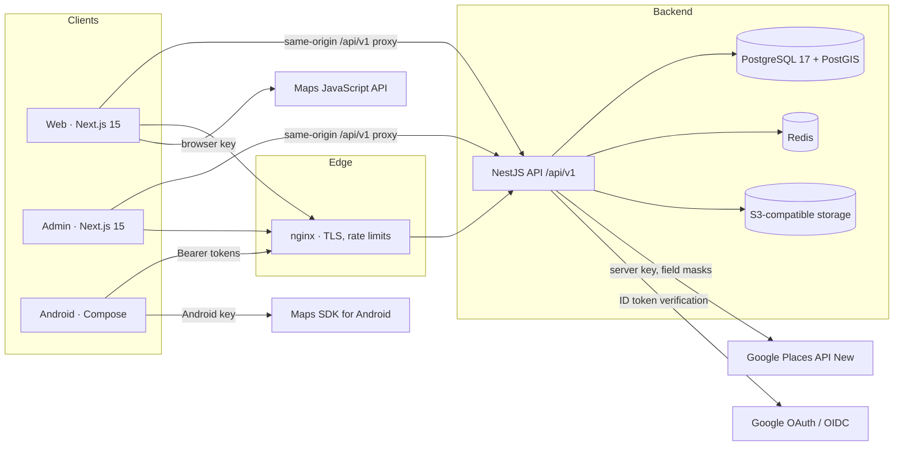
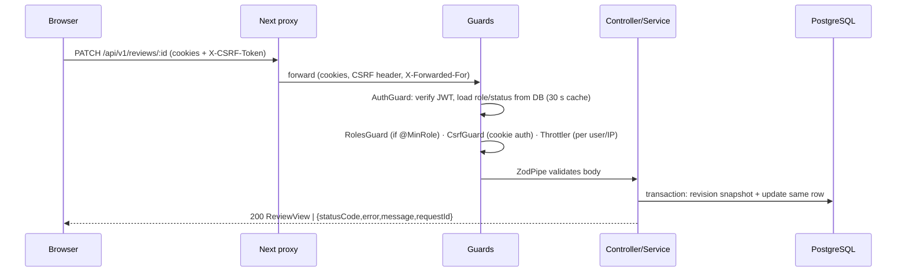

# System Architecture

## Overview

* **Web and admin never call the API cross-origin.** A runtime proxy route (`src/app/api/v1/[...path]/route.ts`)
  forwards requests to `API_INTERNAL_URL`, so session cookies are first-party and the CSRF double-submit
  cookie is readable by the page. The upstream URL is read per request, so one Docker image works in every environment.
* **Android** uses short-lived Bearer access tokens + rotating refresh tokens stored with Android Keystore encryption.
* **Google content is fetched live** by the API (server key) and never persisted (see [GOOGLE_MAPS.md](../integrations/GOOGLE_MAPS.md)).

## Backend modules (`apps/api/src/modules`)

| Module | Responsibility |
|---|---|
| `auth` | Google OAuth (web: auth-code + PKCE + state + nonce; Android: native ID token + server nonce), refresh rotation with reuse detection, logout, dev login (dev only) |
| `users` | Profile, preferences, search history, account deletion (anonymization) |
| `places` | Google Places (New) client with explicit field masks; nearby/text search/autocomplete/details/photos/external reviews; discovery filters, sorting, Surprise Me |
| `restaurants` | Internal restaurant references (UUID ↔ Google Place ID), community statistics, ≤30-day coordinate cache, platform links |
| `categories` | Category ↔ Google type mapping (admin-editable) |
| `reviews` | Review engine: one review per user/restaurant, revisions, spam heuristics, reactions, reports, auto-hide |
| `uploads` | Content-validated image upload, EXIF/GPS stripping, WebP variants, local/S3 storage |
| `collections`, `favorites` | Personal lists |
| `community` | Badges (verifiable, quality-gated), leaderboard, home sections |
| `notifications` | In-app notifications (moderation notices cannot be muted) |
| `admin` | Overview analytics, user management, moderation, reports, restaurant merge/duplicates, platform-link verification, categories, audit logs, config, integration health, storage |
| `integrations` | Delivery-platform adapter registry, integration health tracking |
| `retention` | Scheduled purges (Google coordinate cache, orphan uploads, search history, sessions, deleted-account text) |
| `health` | Liveness, readiness (DB + PostGIS + Redis), Prometheus metrics |

Cross-cutting (`src/common`): global guards (Auth → Roles → CSRF → Throttler), zod validation pipe, consistent error
envelope, request ID + structured access logs (coordinates never logged), metrics, audit service, runtime config.

## Request lifecycle

## Discovery flow

1. Client gets a one-shot location (or manual area / map centre) — never background tracking.
2. `GET /places/nearby?lat&lng&radius=5000&categories&budget&sort` (radius ∈ 1/2/3/5/10 km).
3. API calls `places:searchNearby` with a **circle `locationRestriction`** and an explicit field mask
   (categories without Google types use `places:searchText` with a location bias).
4. Results are normalized, distance computed (haversine), **re-filtered to the radius**, joined with MAM! community stats,
   filtered (budget/rating/open-now only when data exists — missing data is counted, never guessed) and sorted.
5. If Google is unavailable, the API returns community restaurants within the radius via **PostGIS `ST_DWithin`**,
   with an explicit provider status so the UI shows a notice.

## Design system

`packages/design-tokens/src/index.ts` is the single source of truth. `npm run build -w @mam/design-tokens` emits
CSS custom properties (light + dark), a Tailwind preset used by web and admin, and
`apps/android/.../ui/theme/MamTokens.kt` for Compose. Chart colours were validated with a CVD/contrast checker.

## Key decisions

| Decision | Rationale |
|---|---|
| Zod schemas shared by API and web | One validation source; Swagger generated from the same schemas |
| Same-origin proxy instead of CORS cookies | First-party cookies, simpler CSRF, works behind any domain |
| Role & status read from DB on every request (cached 30 s) | Suspension and demotion take effect immediately; tokens can't carry stale privileges |
| Google names fetched live, not stored | Google Maps Platform terms permit storing Place IDs (indefinitely) and lat/lng (≤ 30 days) only |
| Manual DI on Android | Fewer build-time dependencies (no kapt/KSP), explicit wiring, easy fakes in tests |
| In-memory fallbacks for Redis | Local development without Docker; production should run Redis for multi-instance rate limits |
