# Database Design

PostgreSQL 17 with **PostGIS 3.6**, `citext` and `pgcrypto`. Schema: `apps/api/prisma/schema.prisma`.
Migrations: `apps/api/prisma/migrations` (generated init + hand-written constraints/GiST index).
Tables use `snake_case`; all primary keys are UUIDs; timestamps are `timestamptz(3)`.

## ERD (core)

```mermaid
erDiagram
  users ||--|| user_profiles : has
  users ||--o| user_preferences : has
  users ||--o{ oauth_accounts : links
  users ||--o{ sessions : "refresh sessions"
  users ||--o{ reviews : writes
  users ||--o{ review_photos : uploads
  users ||--o{ review_reactions : reacts
  users ||--o{ review_reports : reports
  users ||--o{ collections : owns
  users ||--o{ favorites : saves
  users ||--o{ user_badges : earns
  users ||--o{ notifications : receives
  users ||--o{ search_history : searches
  users ||--o{ admin_audit_logs : "acts (actor)"
  restaurants ||--o{ external_place_refs : "identified by"
  restaurants ||--o{ restaurant_categories : tagged
  categories ||--o{ restaurant_categories : groups
  restaurants ||--o{ reviews : receives
  restaurants ||--o{ restaurant_platform_links : "delivery links"
  restaurants ||--o{ collection_items : in
  restaurants ||--o{ favorites : in
  restaurants |o--o{ restaurants : "merged into"
  reviews ||--o{ review_photos : has
  reviews ||--o{ review_reactions : has
  reviews ||--o{ review_reports : has
  reviews ||--o{ moderation_actions : has
  reviews ||--o{ review_revisions : snapshots
  collections ||--o{ collection_items : contains
```



Plus `integration_status` (provider health counters) and `app_config` (admin-editable runtime config).

## Tables

| Table | Purpose / notable columns |
|---|---|
| `users` | `email citext unique`, `email_verified`, `status (ACTIVE/SUSPENDED/DELETED)`, `role (USER/MODERATOR/ADMIN/SUPER_ADMIN)`, `last_active_at`, `deleted_at` |
| `user_profiles` | `username citext unique`, `display_name`, `avatar_url`, `bio`, `location_visibility` |
| `oauth_accounts` | `(provider, provider_account_id)` unique. **No OAuth tokens stored.** |
| `sessions` | SHA-256 hash of refresh token, `family_id` (reuse detection), `client`, `expires_at`, `revoked_at` |
| `user_preferences` | default radius (CHECK ∈ 1/2/3/5/10 km), categories, budget, history/notification toggles |
| `restaurants` | internal UUID, `status (ACTIVE/MERGED/CLOSED/HIDDEN)`, `name` (**community/admin only**), `location geography(Point,4326)`, `location_cached_at`, `merged_into_id` |
| `external_place_refs` | `(provider, external_place_id)` **unique** — Google Place IDs are stored indefinitely (permitted) |
| `categories`, `restaurant_categories` | category ↔ Google types; source (GOOGLE_TYPE/COMMUNITY/ADMIN) |
| `restaurant_platform_links` | delivery links: `availability (VERIFIED/UNVERIFIED/UNAVAILABLE/NOT_INTEGRATED)`, `source`, `last_verified_at` |
| `reviews` | five 1–5 ratings, `overall_rating numeric(3,2)`, text, `price_paid int` (IDR), `currency`, `visit_type`, `visited_at date`, `status`, `moderation_locked`, `edit_count`, `quality_score`, `deleted_at` |
| `review_revisions` | immutable JSON snapshot before each edit/delete/moderation |
| `review_photos` | `storage_key`, `thumb_key`, `mime_type`, `file_size`, `width`, `height`, `sha256`, `deleted_at` |
| `review_reactions` | `(review_id, user_id, type)` unique |
| `review_reports` | `(review_id, reporter_id)` unique; status, resolver, note |
| `moderation_actions` | action, reason, previous/new status, moderator (NULL = automatic) |
| `collections`, `collection_items` | `(collection_id, restaurant_id)` unique; soft delete on collections |
| `favorites` | `(user_id, restaurant_id)` unique |
| `user_badges` | `(user_id, code)` unique |
| `notifications` | indexed by `(user_id, read_at, created_at desc)` |
| `admin_audit_logs` | actor, action, target, JSON metadata, IP, UA |
| `search_history` | text only (no location), purged after 90 days |
| `integration_status` | per-provider success/error/latency counters (24 h window) |
| `app_config` | key → JSON value overrides |

## Business rules enforced by the database

| Rule | Mechanism |
|---|---|
| One review per user per restaurant | `UNIQUE (user_id, restaurant_id)` on `reviews` |
| Ratings 1–5 | `CHECK` per dimension |
| Overall = mean of 5 dimensions | `CHECK overall_rating = ROUND(sum/5, 2)` |
| Soft-delete consistency | `CHECK (status = 'DELETED') = (deleted_at IS NOT NULL)` |
| Google coordinate cache well-formed | `CHECK (location IS NULL) = (location_cached_at IS NULL)` |
| Merge integrity | `CHECK (status = 'MERGED') = (merged_into_id IS NOT NULL)`, no self-merge |
| Photo constraints | MIME whitelist, size ≤ 8 MB, positive dimensions |
| Unique external identity | `UNIQUE (provider, external_place_id)` |

### Deleted reviews and the uniqueness rule

A user-deleted review stays as a `DELETED` row (auditability). If the user reviews the same restaurant again, the
**same row is revived** (a `RECREATE_AFTER_DELETE` revision is written first), so the unique constraint is never
violated and there is never more than one active review. Reviews deleted **by a moderator** set
`moderation_locked = true` and cannot be revived by the author.

## Indexes

* `restaurants_location_gist` — GiST on `location` for `ST_DWithin`/`ST_Distance`.
* `reviews (restaurant_id, status, created_at desc)`, `(status, created_at desc)`, `(user_id, status)`.
* Partial: `review_reports (created_at) WHERE status='OPEN'`, `reviews (created_at) WHERE status='PENDING'`.
* `notifications (user_id, read_at, created_at desc)`, `admin_audit_logs (created_at desc)`, `(actor_id, created_at)`, `(action)`.

## Geographic queries

```sql
-- community places within radius (spheroidal distance in metres)
SELECT id, ST_Distance(location, ST_SetSRID(ST_MakePoint(:lng, :lat), 4326)::geography) AS d
  FROM restaurants
 WHERE location IS NOT NULL AND status = 'ACTIVE'
   AND ST_DWithin(location, ST_SetSRID(ST_MakePoint(:lng, :lat), 4326)::geography, :radius)
 ORDER BY d;
```

## Data retention (RetentionService, every 6 h, advisory-locked)

| Data | Retention |
|---|---|
| Restaurant coordinates from Google | ≤ 30 days (`location_cached_at`), refreshed when the place reappears in live results |
| Unattached photo uploads | 24 h |
| Search history | 90 days |
| Expired / revoked sessions | at expiry / 30 days after revocation |
| Read notifications | 180 days |
| Review text of deleted accounts | scrubbed 30 days after deletion |

## Connection pooling & migrations

Use `?connection_limit=10` (per API instance) in `DATABASE_URL`, or PgBouncer in transaction mode for many instances.
Apply migrations with `npx prisma migrate deploy` (CI runs a drift check with `prisma migrate diff --exit-code`).
